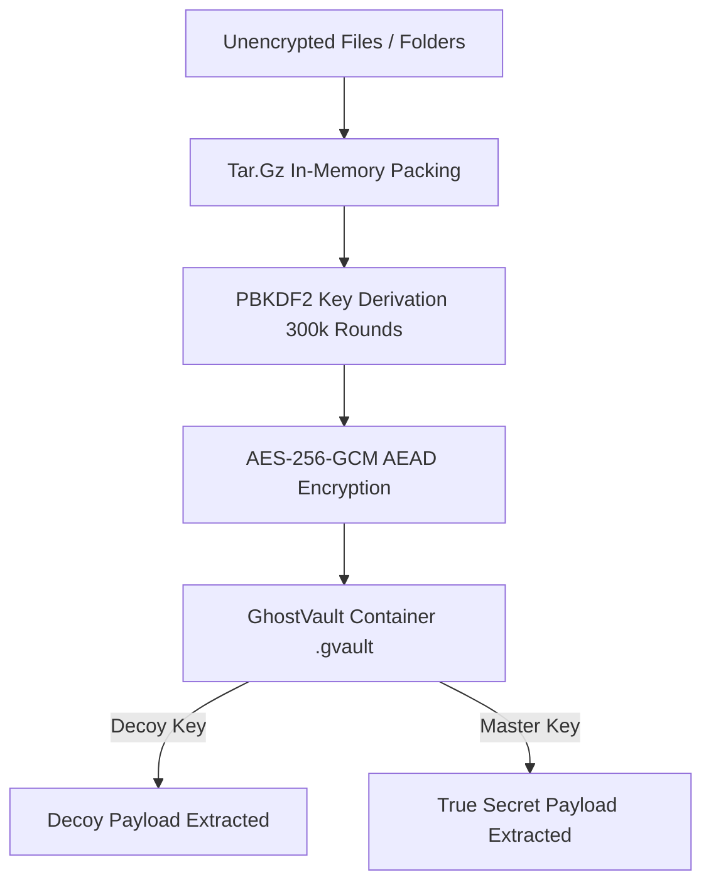

# 🛡️ GhostVault-CLI

<div align="center">

```
  ██████╗ ██╗  ██╗ ██████╗ ███████╗████████╗██╗   ██╗ █████╗ ██╗   ██╗██╗  ████████╗
 ██╔════╝ ██║  ██║██╔═══██╗██╔════╝╚══██╔══╝██║   ██║██╔══██╗██║   ██║██║  ╚══██╔══╝
 ██║  ███╗███████║██║   ██║███████╗   ██║   ██║   ██║███████║██║   ██║██║     ██║   
 ██║   ██║██╔══██║██║   ██║╚════██║   ██║   ╚██╗ ██╔╝██╔══██║██║   ██║██║     ██║   
 ╚██████╔╝██║  ██║╚██████╔╝███████║   ██║    ╚████╔╝ ██║  ██║╚██████╔╝███████╗██║   
  ╚═════╝ ╚═╝  ╚═╝ ╚═════╝ ╚══════╝   ╚═╝     ╚═══╝  ╚═╝  ╚═╝ ╚═════╝ ╚══════╝╚═╝   
```

**AES-256-GCM Zero-Knowledge File Locker · DoD 5220.22-M Cryptographic Shredder · Decoy Vaults**

[](https://www.python.org/downloads/)
[](https://opensource.org/licenses/MIT)
[](https://github.com/psf/black)
[]()

</div>

---

## ⚡ Overview

**GhostVault-CLI** is a high-security, local zero-knowledge file encryption suite and digital shredder designed for privacy researchers, developers, and forensic resistance. 

Unlike standard archive encryptors, GhostVault incorporates **Plausible Deniability (Decoy Vaults)**: an encrypted container can hold two distinct isolated payloads under two separate passwords. If forced to disclose your key, entering the Decoy password extracts a harmless cover directory without revealing or proving the existence of the primary secret vault.

---

## ✨ Features

- 🔒 **Military-Grade Authenticated Encryption**: AES-256-GCM with PBKDF2-HMAC-SHA256 (300,000 rounds) key derivation and unique 16-byte random salts.
- 🎭 **Plausible Deniability (Dual-Slot Decoy Mode)**: Store a fake decoy payload alongside your true classified vault. Both slots appear as indistinguishable high-entropy cryptographic ciphertext.
- 🗑️ **DoD 5220.22-M 3-Pass File Shredder**: Overwrites targeted data with zeroes (`0x00`), ones (`0xFF`), and cryptographically secure random bytes (`os.urandom`) before randomizing filename metadata and unlinking.
- 📦 **Lossless Directory Packing**: Transparent in-memory tarball serialization with directory structure preservation.
- 💻 **Interactive TUI & Headless CLI**: Beautiful colored terminal interface powered by `rich`, with progress spinners, confirmation gates, and headless automation flags.

---

## 🚀 Installation

```bash
# Clone the repository
git clone https://github.com/loveslaw/GhostVault-CLI.git
cd GhostVault-CLI

# Install dependencies
pip install -r requirements.txt
```

---

## 📖 CLI Usage

### 1. Interactive Menu Mode
Simply run without arguments to launch the guided terminal wizard:
```bash
python main.py
```

### 2. Lock a File or Directory
Encrypt a sensitive folder into an authenticated `.gvault` file:
```bash
python main.py lock ./sensitive_project -o backup.gvault
```

### 3. Plausible Deniability (Decoy Vault)
Create a vault with a secret payload and an innocent decoy payload:
```bash
python main.py lock ./classified_docs \
  --decoy ./harmless_photos \
  -o double_vault.gvault \
  -p "SuperSecretMasterKey!" \
  --decoy-password "InnocentDecoyKey123"
```
- If unlocked with `InnocentDecoyKey123` ➔ extracts `./harmless_photos`.
- If unlocked with `SuperSecretMasterKey!` ➔ extracts `./classified_docs`.

### 4. Lock & Shred Source in One Step
Encrypt the target folder and immediately destroy the unencrypted original using the DoD 3-pass shredder:
```bash
python main.py lock ./confidential_data -o secure.gvault --shred
```

### 5. Unlock Vault
Extract an encrypted vault back to disk:
```bash
python main.py unlock backup.gvault --dest ./extracted/
```

### 6. Permanent File Shredder
Directly wipe and destroy files or folders:
```bash
python main.py shred ./unwanted_secrets.pdf --passes 3
```

---

## 🏗️ Architecture



---

## 🧪 Testing

Run the full automated test suite:
```bash
python -m pytest tests/ -v
```

All 10 unit tests verify key derivation, AEAD authentication tampering, recursive directory shredding, and plausible deniability dual-slot unlocking.

---

## 📜 License

Distributed under the [MIT License](LICENSE).
Author: **loveslaw**
